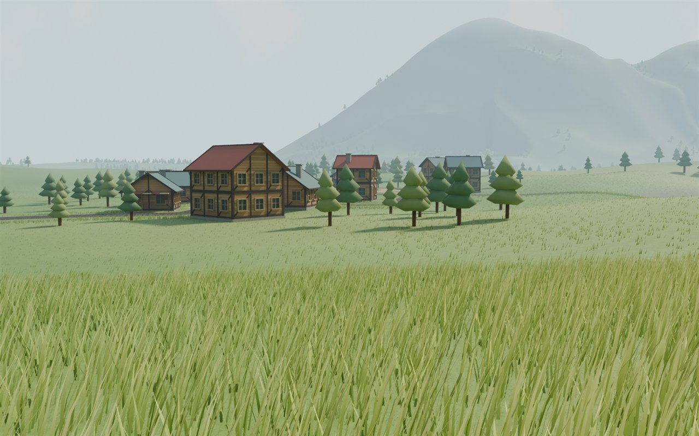
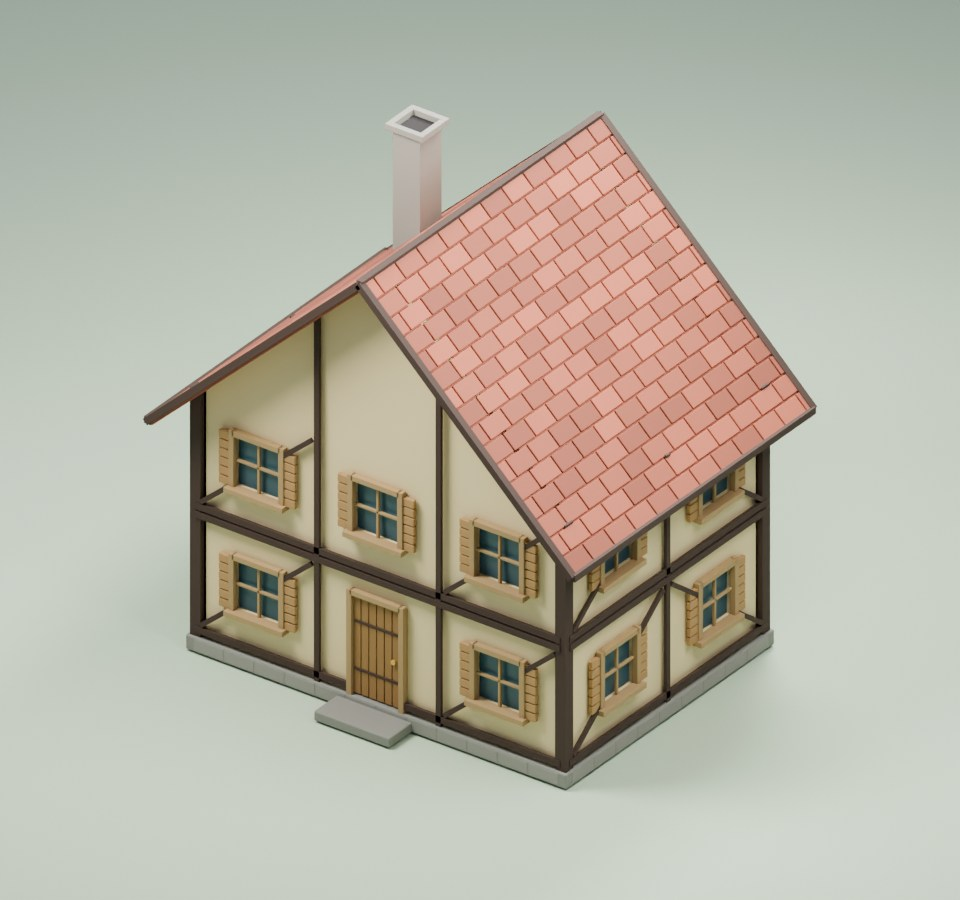
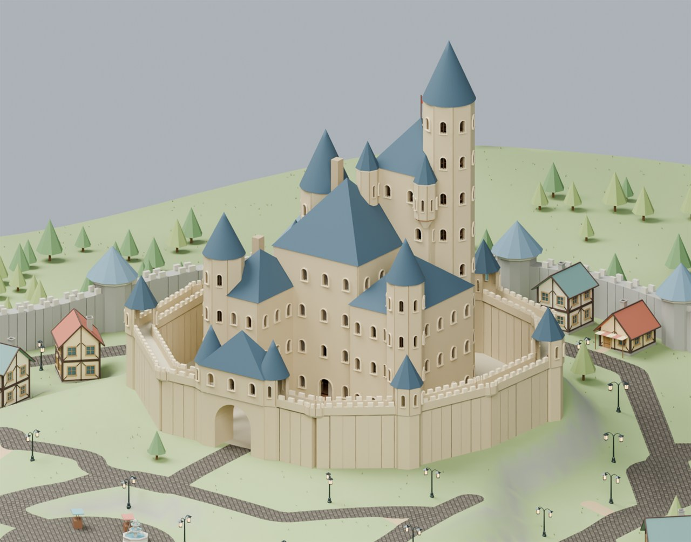
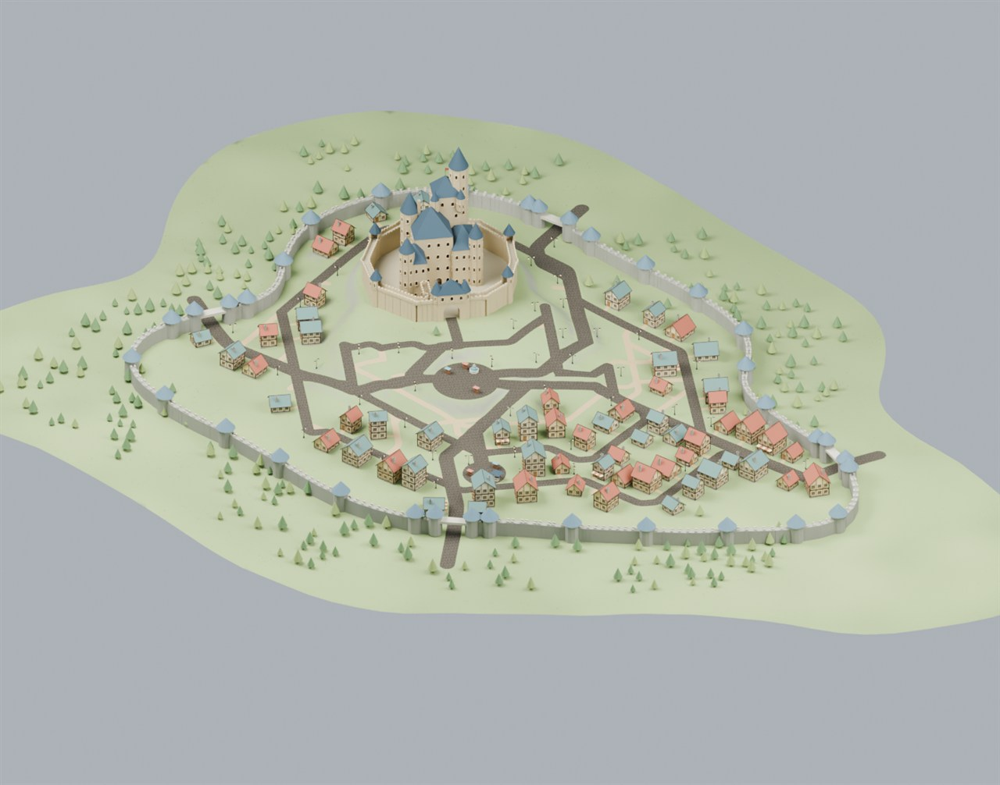
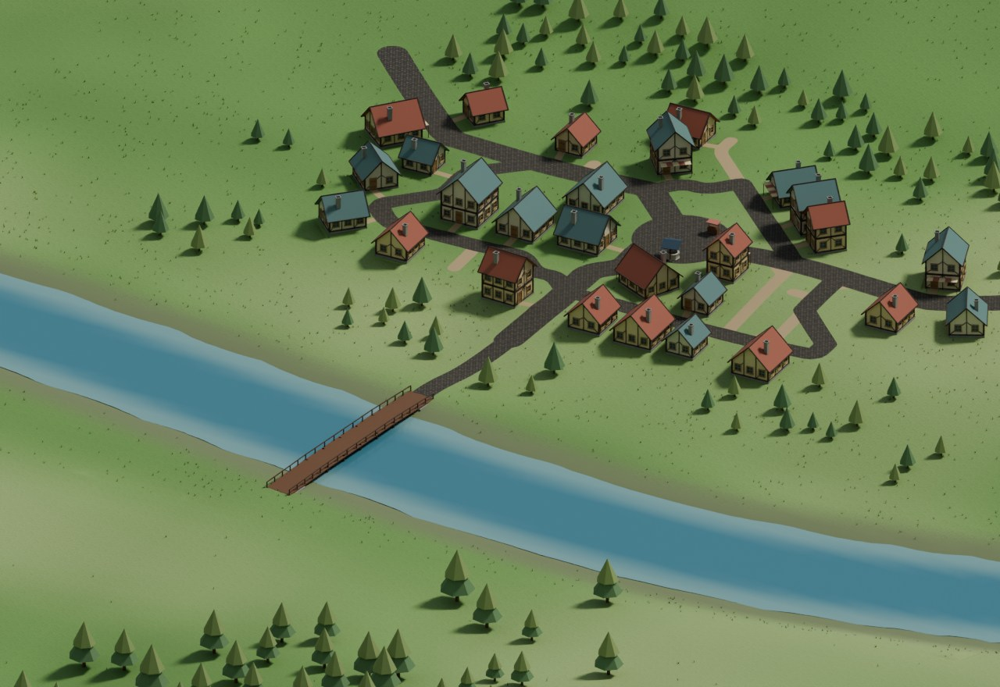

# asgen — Procedural 3D Building, Settlement & World Generator

Blender Python과 표준 라이브러리만으로 **주택·실내·성·도시·소형 월드·대규모 타일 아틀라스**를 절차적으로 생성하고, 필요 시 OGRE Classic C++17 게임 에셋까지 내보내는 범용 생성 도구입니다.

특정 게임의 세계관이나 고정 맵 조건을 코드에 묶지 않고, 사용자가 **JSON 설정 파일**로 지형·해안·산맥·수계·바이옴·도시·던전 구성을 직접 정의해 원하는 형태의 3D 맵을 만들 수 있습니다.



## 생성 예시

| 중세 주택 외관 (목재 골조·덧문·입체 기와) | 성 외관 (본관·주탑·별관·성벽·문루) |
| :---: | :---: |
|  |  |
| **성 실내 (대강당·나선 계단·방·가구 배치)** | **성벽 도시 (지형·도로망·광장·공공시설·성)** |
|  |  |
| **해안 항구 정착지 (해안선·안벽·부두·계류선)** | **강변 정착지 (하천·목조 다리·우물·마을 도로)** |
|  |  |

## 주요 모듈

| 기능 | 진입 스크립트 | 상세 문서 |
|---|---|---|
| 카툰·중세 주택 및 실내·가구 배치 | `assets/code/house_generator.py` | [README](assets/code/README.md) · [INTERIOR](assets/code/INTERIOR.md) |
| 마을·도시·수도, 성벽, 공공시설, 성 외관/실내 | `assets/code/settlement_generator.py` | [SETTLEMENT](assets/code/SETTLEMENT.md) · [CASTLE_INTERIOR](assets/code/CASTLE_INTERIOR.md) · [CIVIC](assets/code/CIVIC.md) |
| 커스텀 소형 월드 (지형·해안·호수·강·정착지) | `assets/code/world_generator.py` | [WORLD](assets/code/WORLD.md) |
| 커스텀 대규모 아틀라스 (256m 타일·기후·도로·던전) | `assets/code/world_generator.py` (`blueprint_version: 2`) | [ATLAS](assets/code/ATLAS.md) |
| 게임 에셋 / OGRE C++17 출력 | `assets/code/ogre_export.py` · `assets/code/ogre/` | [GAME_ASSETS](assets/code/GAME_ASSETS.md) |

## 빠른 시작

### 1. 주택 생성 (Blender)

```powershell
$blender = 'C:\Program Files\Blender Foundation\Blender 5.3\blender.exe'

& $blender --background --factory-startup --python-exit-code 1 `
  --python assets/code/house_generator.py -- `
  --config assets/code/presets/medieval_house.json `
  --output assets/generated/house.blend `
  --render assets/generated/house.png
```

### 2. 도시·성 생성 (Blender)

```powershell
& $blender --background --factory-startup --python-exit-code 1 `
  --python assets/code/settlement_generator.py -- `
  --config assets/code/presets/settlement_city.json `
  --output assets/generated/city.blend `
  --render assets/generated/city.png
```

### 3. 커스텀 소형 월드 생성

`assets/code/presets/world_example.json`을 복사해 크기, 해안, 산/계곡/언덕/평원, 호수, 강, 정착지 입지를 원하는 대로 바꿀 수 있습니다.

```powershell
# Blender 없이 평면 계획과 SVG 지도 먼저 확인
uv run --no-project --python 3.13 python assets/code/world_generator.py `
  --config assets/code/presets/world_example.json `
  --layout-output assets/generated/world_plan.json `
  --map assets/generated/world_map.svg
```

### 4. 커스텀 대규모 아틀라스 생성

`assets/code/presets/atlas_example.json`을 복사하거나 `"extends"`로 기존 JSON 블루프린트를 상속해 원하는 대륙·왕국·도시·던전을 구성합니다.

```powershell
# Blender 없이 전체 아틀라스 계획 + SVG 지도 생성
uv run --no-project --python 3.13 python assets/code/world_generator.py `
  --config assets/code/presets/atlas_example.json `
  --layout-output assets/generated/atlas_plan.json `
  --map assets/generated/atlas_map.svg

# Blender에서 대표 도시 타일 빌드 및 툰 미리보기 렌더
& $blender --background --factory-startup --python-exit-code 1 `
  --python assets/code/world_generator.py -- `
  --config assets/code/presets/atlas_example.json --toon `
  --output assets/generated/atlas_preview.blend `
  --render assets/generated/atlas_preview.png
```

외부 프로젝트의 게임 전용 맵 블루프린트도 `--config <경로/my_game_map.json>`으로 그대로 실행할 수 있습니다.

## 코드 스타일 및 테스트

자세한 코딩 규칙과 검증 명령은 [codingstyle.md](codingstyle.md)를 참고하세요.

```powershell
# Python 생성 규칙 테스트 (Blender 불필요)
uv run --no-project --python 3.13 python -m unittest discover -s assets/code/tests -p 'test_*.py' -v

# Ruff 린트 및 포맷 검사
uv tool run --from ruff==0.17.5 ruff check .
uv tool run --from ruff==0.17.5 ruff format --check .
```
