# asgen — Procedural 3D Building, Settlement & World Generator

Blender Python과 표준 라이브러리만으로 **주택·실내·성·도시·소형 월드·대규모 타일 아틀라스**를 절차적으로 생성하고, 필요 시 OGRE Classic C++17 게임 에셋까지 내보내는 범용 생성 도구입니다.

특정 게임의 세계관이나 고정 맵 조건을 코드에 묶지 않고, 사용자가 **JSON 설정 파일**로 지형·해안·산맥·수계·바이옴·도시·던전 구성을 직접 정의해 원하는 형태의 3D 맵을 만들 수 있습니다.

> **개발 진행 중 (Work in Progress)**
> 이 저장소는 현재 실사풍(`REALISTIC`) 에셋·성채·월드 생성 기능을 계속 고도화하는 중이며 아직 완성 단계가 아닙니다. 특히 **대륙 전체를 절차적으로 구성하고 바이옴·산맥·대협곡·대하·정착지를 하나의 광역 월드로 통합 생성하는 기능**은 현재 프로토타입 및 확장 작업이 진행 중입니다.


## 생성 예시

### 카툰풍과 실사풍 비교

같은 중세 주택을 같은 시드와 카메라로 렌더했습니다. 왼쪽은 **카툰풍**, 오른쪽은 **실사풍**입니다.

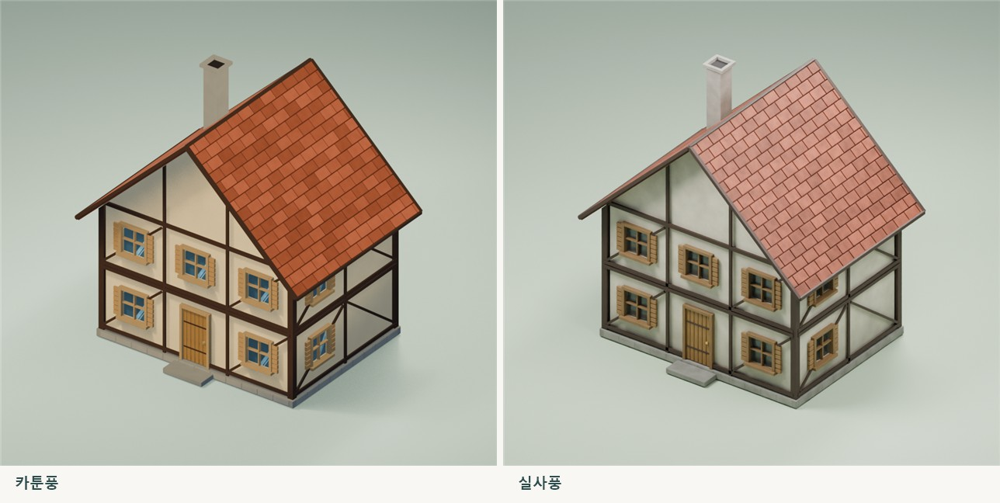

아래 풍경도 같은 위치에서 렌더했습니다. 왼쪽과 오른쪽의 활엽수 잎, 침엽수 가지, 기와의 굴곡을 비교할 수 있습니다.

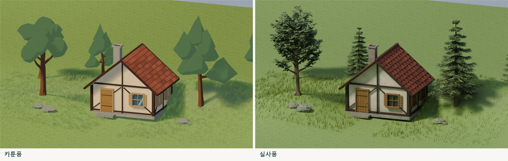

주택·도시·월드의 Blender 패널에서 **표현 스타일**을 선택할 수 있습니다. 기본값은 카툰풍입니다. JSON 최상위에 `"art_style": "REALISTIC"`을 지정하거나 생성 명령에 `--art-style REALISTIC`을 추가하면 실사풍으로 제작합니다. 같은 옵션을 아틀라스에도 사용할 수 있으며 기존 월드 옵션 `--toon`은 카툰풍을 선택합니다.

카툰풍 미리보기는 EEVEE에서 단계 명암을 표현합니다. 실사풍 미리보기는 Cycles에서 물리 기반 하늘(`MULTIPLE_SCATTERING`)과 절차적 다중 스케일 PBR 셰이더(풍화·이끼·거칠기 변화·범프·납틀 투과 유리)를 렌더합니다. OGRE 출력은 기존 게임용 재질과 텍스처 형식을 그대로 유지합니다.

실사풍(`REALISTIC`)에는 다음과 같은 디테일이 적용됩니다.
- **건축·주택**: 굴곡진 입체 기와와 용마루, 계층화된 목재 골조, 정착지·주택별 굴뚝 마감 변형(`AUTO` / `OPEN` / `STONE_CAP` / `POTS`, `--chimney-cap` 옵션으로 개별 지정 가능)
- **성벽·성채·마을 시설**: 판타지적 스케일이 가미된 높은 외성벽(경사 석축 기단·부벽·돌출 성가퀴·쌍탑 바비칸 성문·철격자·원뿔 첨탑), 강변 다중 아치 돌다리와 물레방아, 광장 옆 오픈 종루 종탑(`BELL_TOWER`), 박공 천막 시장 부스
- **식생·지형·자연물**: 접힌 잎 활엽수와 층상 침엽수, 방사형 능선 산악(`MOUNTAIN` / `MOUNTAIN_RANGE`), 계단식 퇴적층 거대 협곡(`CANYON`), 비대칭 사막 사구(`DESERT`), 습지·늪(`MARSH` / `MARSH_POOL`), 호수·작은 못(`LAKE` / `POND`), 강·산간 개울(`RIVER` / `STREAM`), 자연 암석 동굴(`Cave`)과 갈대·바위

### 실사풍 월드·성채 생성 예시 (개발 중 / WIP)

> 아래 월드 렌더는 [world_monumental_realistic.json](assets/code/presets/world_monumental_realistic.json) 프로토타입 프리셋을 기반으로 중앙 거대 설산, 양갈래 산맥, 붉은 사암 대협곡·협곡 강, 빙하 연못 발원 대하·개울, 사막·늪·호수·4개 정착지를 배치해 검증한 중간 결과물입니다. 대륙 전체 스케일 생성 및 광역 아틀라스 통합은 계속 개발 중입니다.

| 실사풍 중세 주택 (Cycles PBR) | 강변 성문·돌 아치 다리·물레방아·종탑·성채 |
| :---: | :---: |
| 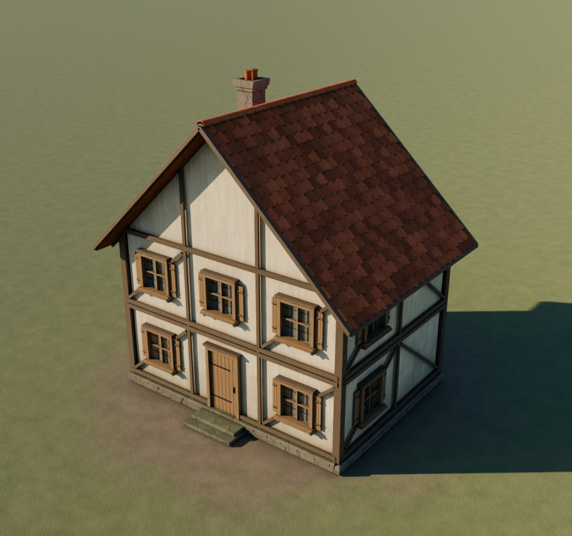 | 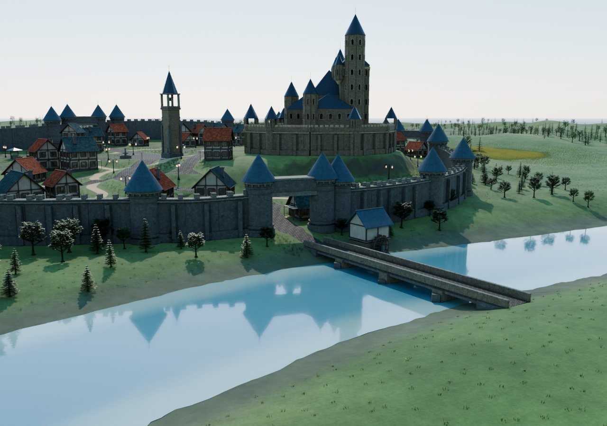 |
| **중앙 설산 기슭의 성채 도시 (`citadel_ford`)** | **중앙 설산·산맥·대협곡·대하로 나뉜 월드 프로토타입** |
| 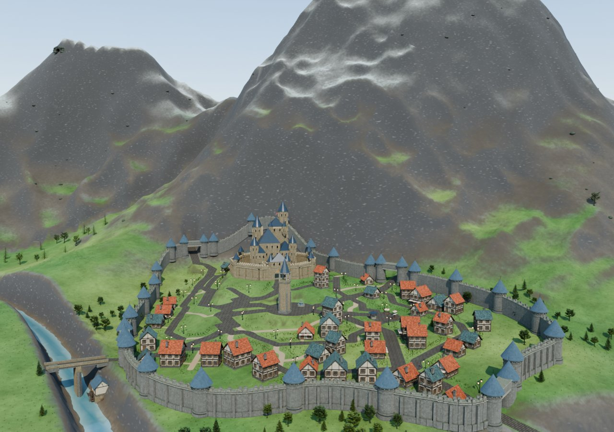 | 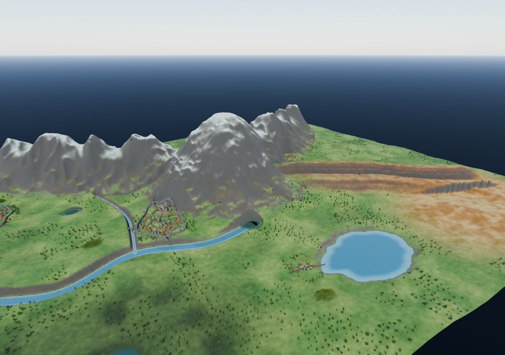 |

### 건물과 정착지

| 중세 주택 외관 (목재 골조·덧문·입체 기와) | 성 외관 (본관·주탑·별관·성벽·문루) |
| :---: | :---: |
|  |  |
| **성 실내 (대강당·나선 계단·방·가구 배치)** | **성벽 도시 (지형·도로망·광장·공공시설·성)** |
| 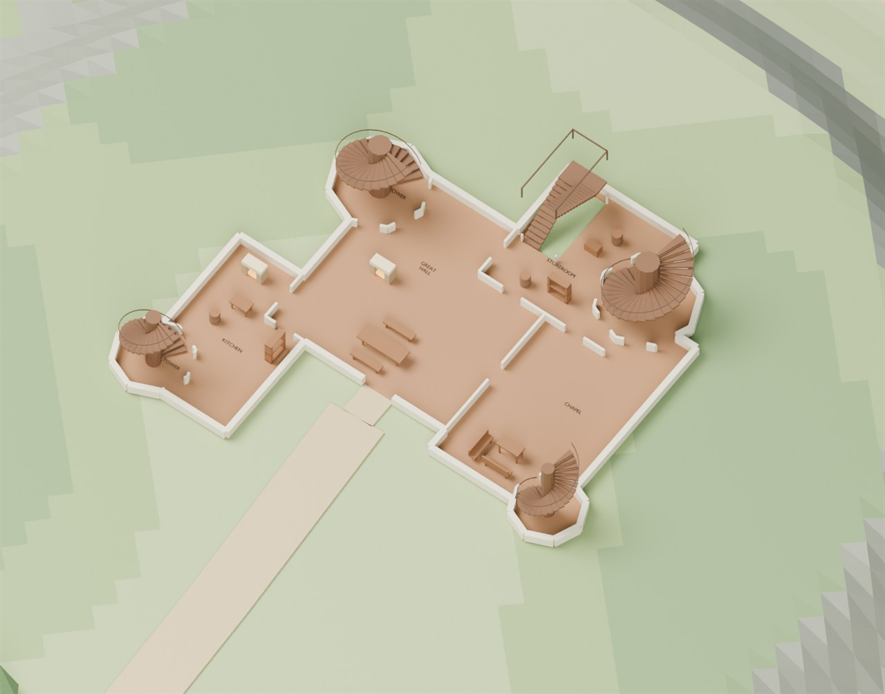 |  |
| **해안 항구 정착지 (해안선·안벽·부두·계류선)** | **강변 정착지 (하천·목조 다리·우물·마을 도로)** |
| 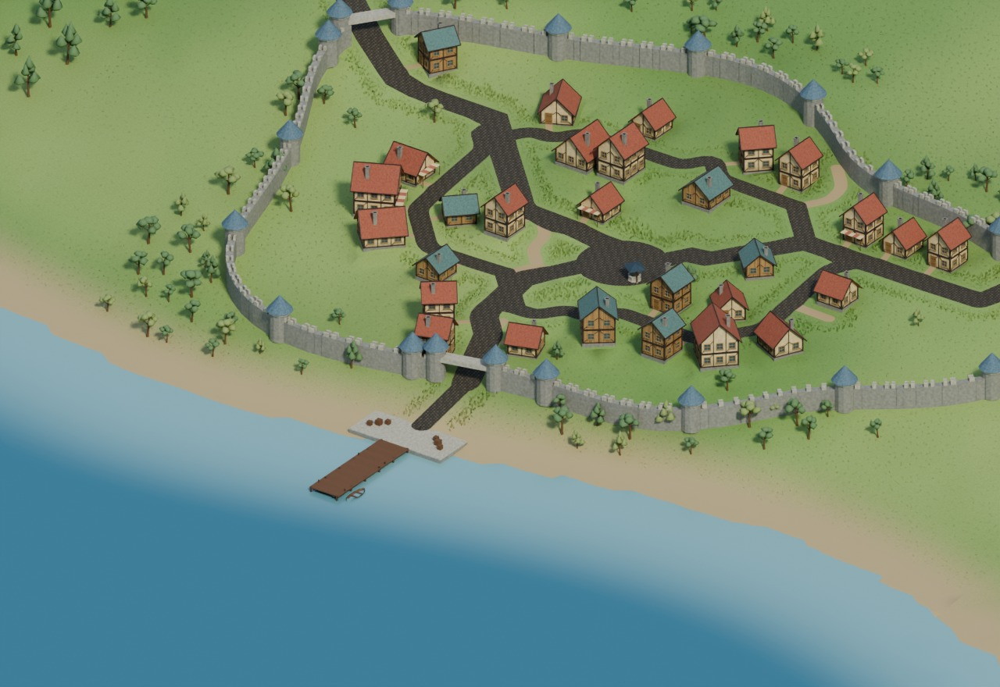 |  |
| **성당 (중앙 신랑·측랑·버팀벽)** | **모스크 (돔·안뜰·기도실)** |
| 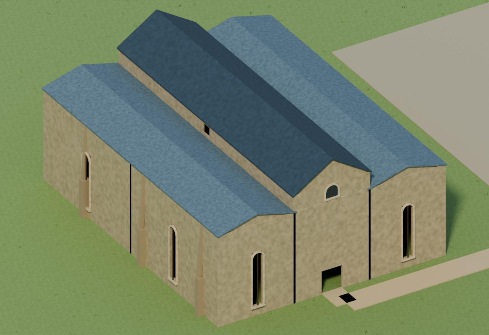 | 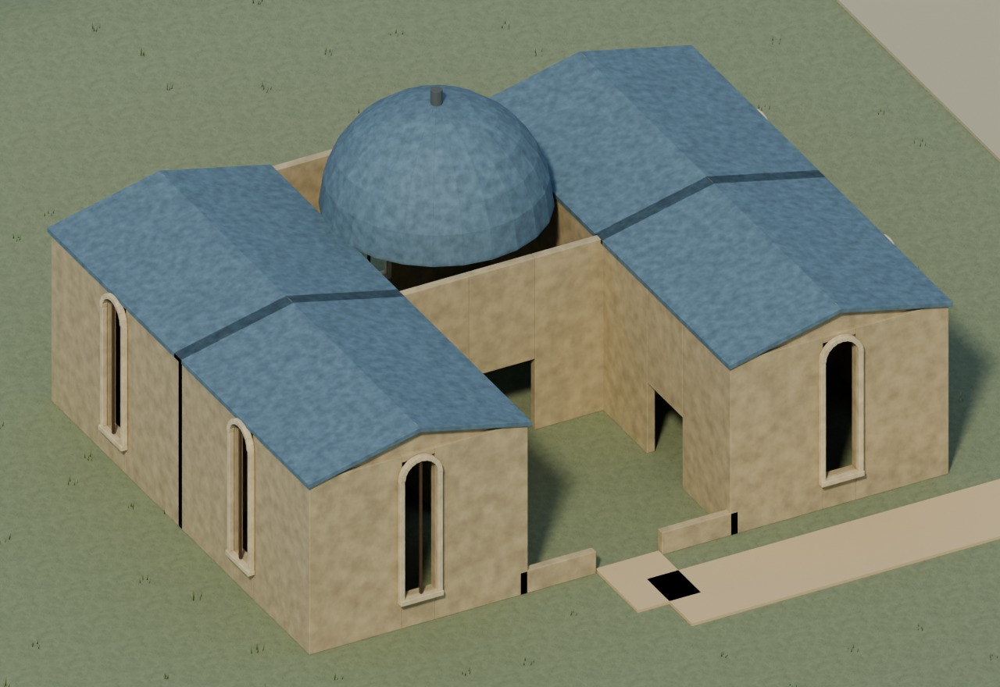 |
| **카타콤 던전 (묘실·석관)** | **지하 보고 던전 (저장실·봉인석)** |
| 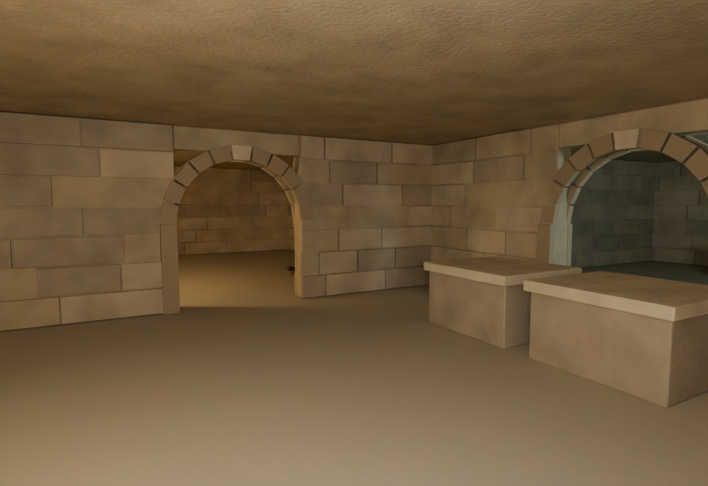 | 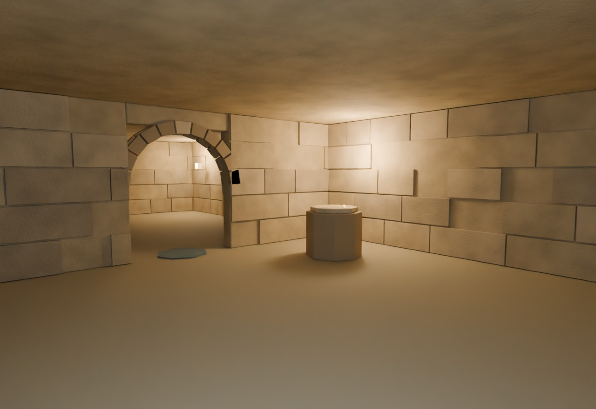 |

## 주요 모듈

| 기능 | 진입 스크립트 | 상세 문서 |
|---|---|---|
| 카툰풍·실사풍 중세 주택 및 실내·가구 배치 | `assets/code/house_generator.py` | [README](assets/code/README.md) · [INTERIOR](assets/code/INTERIOR.md) |
| 마을·도시·수도, 성벽, 공공시설, 성 외관/실내 | `assets/code/settlement_generator.py` | [SETTLEMENT](assets/code/SETTLEMENT.md) · [CASTLE_INTERIOR](assets/code/CASTLE_INTERIOR.md) · [CIVIC](assets/code/CIVIC.md) |
| 커스텀 소형 월드 (지형·해안·호수·강·정착지) | `assets/code/world_generator.py` | [WORLD](assets/code/WORLD.md) |
| 커스텀 대규모 아틀라스 (256m 타일·기후·도로·던전) | `assets/code/world_generator.py` (`blueprint_version: 2`) | [ATLAS](assets/code/ATLAS.md) |
| 게임 에셋 / OGRE C++17 출력 | `assets/code/ogre_export.py` · `assets/code/ogre/` | [GAME_ASSETS](assets/code/GAME_ASSETS.md) |

## 빠른 시작

### 1. 주택 생성 (Blender)

```powershell
$blender = 'C:\Program Files\Blender Foundation\Blender 5.3\blender.exe'

& $blender --background --factory-startup --python-exit-code 1 `
  --python assets/code/house_generator.py -- `
  --config assets/code/presets/medieval_house.json `
  --output assets/generated/house.blend `
  --render assets/generated/house.png
```

### 2. 도시·성 생성 (Blender)

```powershell
& $blender --background --factory-startup --python-exit-code 1 `
  --python assets/code/settlement_generator.py -- `
  --config assets/code/presets/settlement_city.json `
  --output assets/generated/city.blend `
  --render assets/generated/city.png
```

### 3. 커스텀 월드 생성 (소형 월드 · 실사 프로토타입)

`assets/code/presets/world_example.json`(기본 소형 월드) 또는 `assets/code/presets/world_monumental_realistic.json`(중앙 거대 설산·산맥·협곡·사막·늪·개울·동굴·물레방아·종탑·성채 도시 포함 실사 프로토타입)을 복사해 원하는 지형과 정착지 구성을 만들 수 있습니다.

```powershell
# Blender 없이 평면 계획과 SVG 지도 먼저 확인
uv run --no-project --python 3.13 python assets/code/world_generator.py `
  --config assets/code/presets/world_monumental_realistic.json `
  --layout-output assets/generated/world_plan.json `
  --map assets/generated/world_map.svg

# Blender Cycles로 성채 도시 포커스 렌더
& $blender --background --factory-startup --python-exit-code 1 `
  --python assets/code/world_generator.py -- `
  --config assets/code/presets/world_monumental_realistic.json `
  --focus citadel_ford `
  --output assets/generated/world_realistic.blend `
  --render assets/generated/world_realistic.png
```

### 4. 커스텀 대규모 아틀라스 / 대륙 생성 (개발 중 / WIP)

`assets/code/presets/atlas_example.json`을 복사하거나 `"extends"`로 기존 JSON 블루프린트를 상속해 원하는 대륙·왕국·도시·던전을 구성합니다.

```powershell
# Blender 없이 전체 아틀라스 계획 + SVG 지도 생성
uv run --no-project --python 3.13 python assets/code/world_generator.py `
  --config assets/code/presets/atlas_example.json `
  --layout-output assets/generated/atlas_plan.json `
  --map assets/generated/atlas_map.svg

# Blender에서 대표 도시 타일 빌드 및 툰 미리보기 렌더
& $blender --background --factory-startup --python-exit-code 1 `
  --python assets/code/world_generator.py -- `
  --config assets/code/presets/atlas_example.json --toon `
  --output assets/generated/atlas_preview.blend `
  --render assets/generated/atlas_preview.png
```

외부 프로젝트의 게임 전용 맵 블루프린트도 `--config <경로/my_game_map.json>`으로 그대로 실행할 수 있습니다.

## 코드 스타일 및 테스트

자세한 코딩 규칙과 검증 명령은 [codingstyle.md](codingstyle.md)를 참고하세요.

```powershell
# Python 생성 규칙 테스트 (Blender 불필요)
uv run --no-project --python 3.13 python -m unittest discover -s assets/code/tests -p 'test_*.py' -v

# Ruff 린트 및 포맷 검사
uv tool run --from ruff==0.17.5 ruff check .
uv tool run --from ruff==0.17.5 ruff format --check .
```
